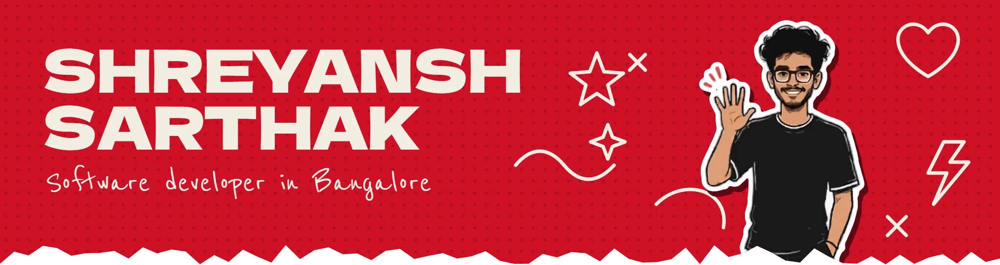
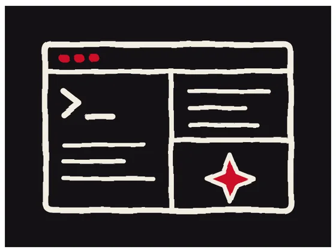
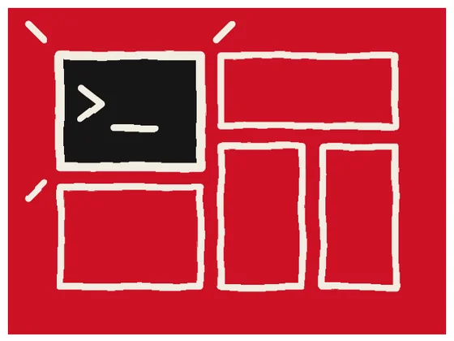
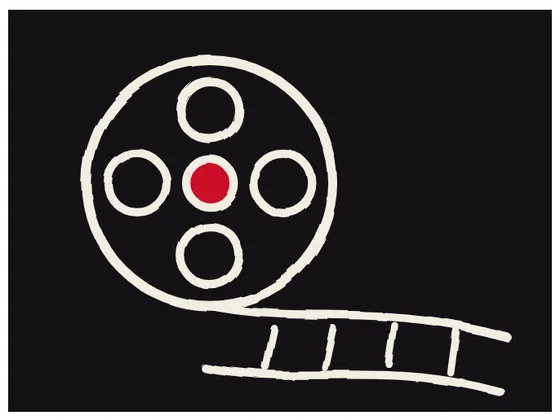
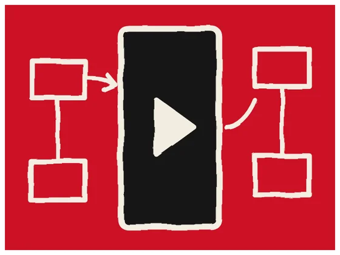
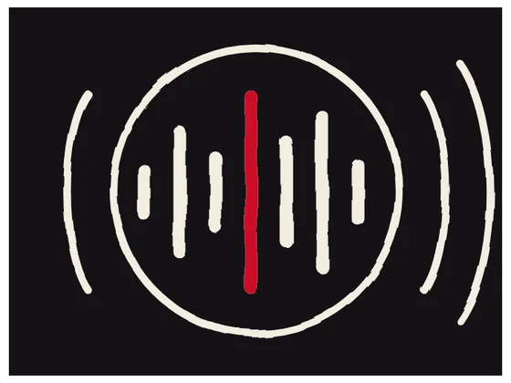
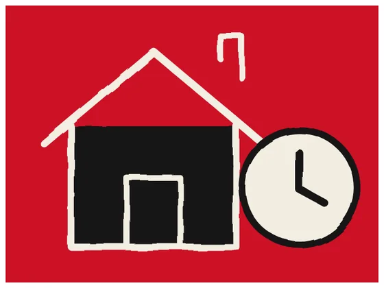
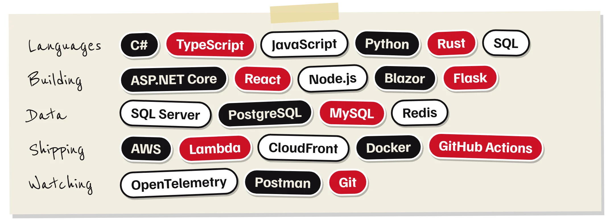
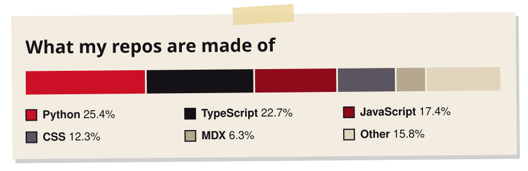
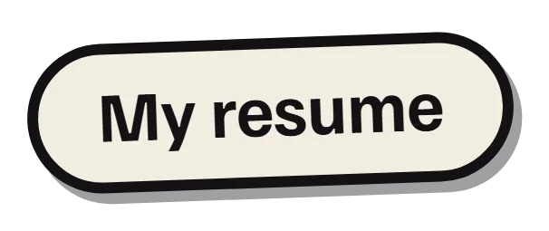

### Hi, I'm Shreyansh.

I'm a software developer at **LeadSquared** in Bangalore, working on web products and the systems behind them. In my own time I build developer tools, try ideas that sound like too much work, and make games.

**See my portfolio:** [sarthax10.github.io](https://sarthax10.github.io/)

**Right now**
- Making [Strata](https://github.com/sarthax10/strata)'s agent pane feel like part of the terminal
- Getting false wake-ups down in [Juno](https://github.com/sarthax10/juno-assistant) without missing the real ones
- Giving [rackwm](https://github.com/sarthax10/rackwm) a configurable keybinding table
- Reading up on how people verify distributed systems

**Off the clock:** hiking, making games, playing games and reading books.

 

| | |
|:---:|:---|
|  | **[Strata](https://github.com/sarthax10/strata)** A Windows terminal with tiling panes and a Claude Code agent built in. Rust, Tauri, TypeScript, React |
|  | **[rackwm](https://github.com/sarthax10/rackwm)** A native tiling window manager for Windows, with a live focus glow and settings that reload as you save them. Rust, Win32 |
|  | **[Antiquary](https://github.com/sarthax10/antiquary)** Turns surprising true history into short, fact-checked videos, with a review desk where a person approves each story. Python, Flask, React, PostgreSQL, Docker |
|  | **[Schematic](https://github.com/sarthax10/schematic)** Writes, storyboards and renders animated engineering explainers, pausing for human review. Python, HTML, JavaScript, ffmpeg |
|  | **[Juno](https://github.com/sarthax10/juno-assistant)** A wake-word voice assistant for Omarchy Linux. Say its name and Claude answers out loud. Python, QML, Whisper |
|  | **[UrbanConnect](https://github.com/sarthax10/urbanConnect)** Books home services without double-booking anyone, with separate customer and admin access. C#, ASP.NET Core, React, MySQL |

On the side, I made **[Watchnight](https://sarthax10.itch.io/watchnight)**, a social deduction horror game with a public playtest.

Got a question, an idea, or a bug in something of mine? I'd like to hear about it.

    

 
