

  

  <a href="#day-shift"><b>☀️ day shift</b></a>
  &nbsp;&nbsp;·&nbsp;&nbsp;
  <a href="#night-shift"><b>🌙 night shift</b></a>
  &nbsp;&nbsp;·&nbsp;&nbsp;
  <a href="#character"><b>🎒 character</b></a>
  &nbsp;&nbsp;·&nbsp;&nbsp;
  <a href="#quests"><b>📜 quest log</b></a>
  &nbsp;&nbsp;·&nbsp;&nbsp;
  <a href="#say-hi"><b>💾 say hi</b></a>

 

Hi, I'm Shreyansh. I have two jobs and one keyboard.

From nine to six I build software that has to hold up, and the pipelines and infrastructure that
ship it: merge engines, window managers, booking systems, CI that stays green. Then the sun goes
down, the tabs change, and I make small, strange games about haunted houses and lying to your
friends.

Same habit on both shifts: build the thing yourself to find out where it breaks.

 

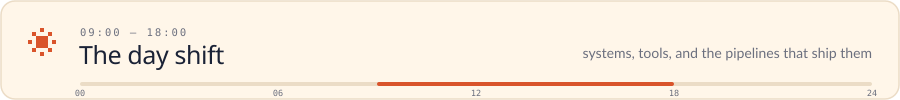

  <a href="https://github.com/sarthax10/strata">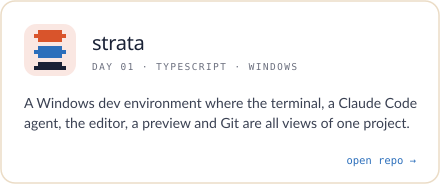</a>
  <a href="https://github.com/sarthax10/rackwm">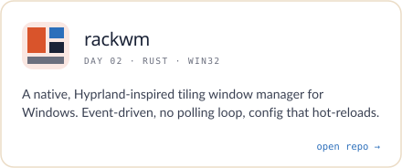</a>
  <a href="https://github.com/sarthax10/tessera">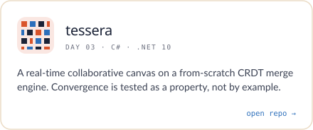</a>
  <a href="https://github.com/sarthax10/juno-assistant">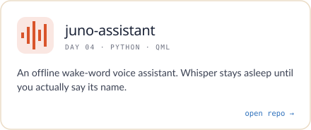</a>
  <a href="https://github.com/sarthax10/urbanConnect">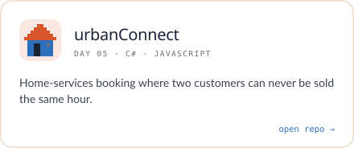</a>
  <a href="https://github.com/sarthax10/antiquary">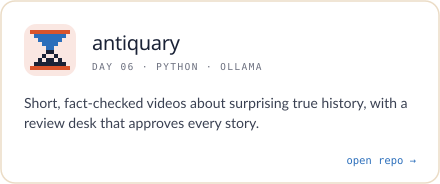</a>

 

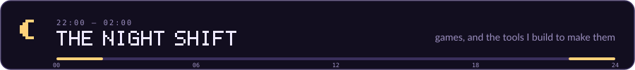

  <a href="https://sarthax10.itch.io/watchnight"></a>

  <a href="https://github.com/sarthax10/gamesmith">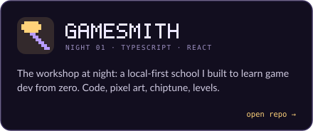</a>
  <a href="https://github.com/sarthax10/schematic">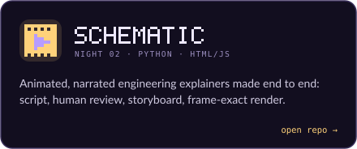</a>

  Watchnight links: <a href="https://sarthax10.itch.io/watchnight">itch.io</a> · <a href="https://sarthax10.github.io/watchnight/">website</a> · <a href="https://github.com/sarthax10/watchnight">site source</a>

 

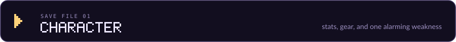

  

  <picture>
    <source media="(prefers-color-scheme: dark)"  srcset="assets/languages-dark.svg">
    <source media="(prefers-color-scheme: light)" srcset="assets/languages-light.svg">
    
  </picture>

&nbsp;Open the full inventory

 

| Slot | Items |
| :-- | :-- |
| ⚔️ **Systems** | Rust · C# · .NET · C · C++ |
| 🛡️ **Web** | TypeScript · JavaScript · Blazor · React · Next.js · Tailwind |
| 🚀 **Ship & run** | CI/CD pipelines · GitHub Actions · Linux · Vercel · Firebase · Git |
| 🧪 **Data & ML** | Postgres · SQL Server · SQLite · MongoDB · Python · NumPy · PyTorch |
| 🎨 **Art & feel** | Godot · Aseprite · Figma · Illustrator · After Effects |

The language chart is refreshed every Monday by a bot that doesn't sleep either.

 

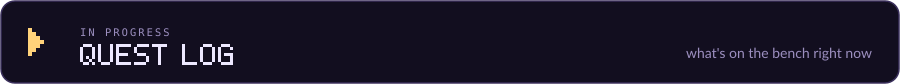

  

 

  

  
  
  
  

&nbsp;↑ ↑ ↓ ↓ ← → ← → B A

 

> 🕹️ **Secret unlocked.** Every game I've shipped started as a "quick prototype after dinner".
> None of them were quick. If you're making something at 2 a.m. too, say hi. We should compare
> bug lists.

  <i>☀️ build it to find out where it breaks &nbsp;·&nbsp; 🌙 then make it fun</i>

<!-- Art is generated: python3 scripts/hero.py · scripts/character.py · scripts/cards.py (fonts: Montserrat, Lato, Fira Code, all SIL OFL; pixel font drawn in scripts/brand.py) -->
